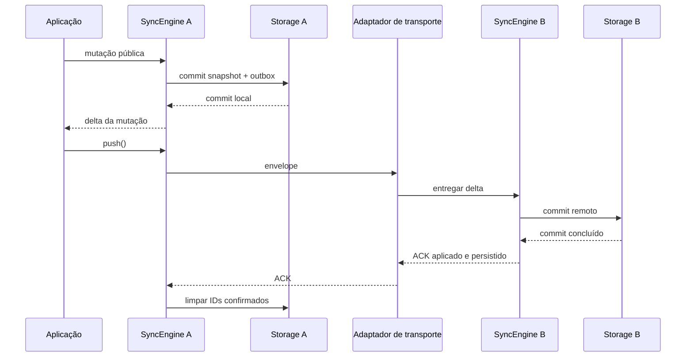

# DeltaSync

Biblioteca Dart modular para aplicações offline-first com CRDTs e sincronização incremental por deltas.

## Pacotes

- `deltasync_core`: LWW, G-Counter, PN-Counter, estado de réplicas e deltas.
- `deltasync_sync`: coordenação de alterações locais, pendências e deltas remotos.
- `deltasync_storage`: contrato de persistência, sem dependência de banco específico.
- `deltasync_transport`: contrato de transporte, sem dependência de HTTP ou WebSocket.
- `deltasync`: facade que exporta APIs dos subpackages.

## Uso

```dart
import 'package:deltasync/deltasync.dart';

final replica = Replica('device-a');
final delta = replica.setDelta('message', 'edited offline');
final remote = Replica('device-b')..apply(Delta([delta]));
print(remote.state.values);
final apples = replica.incrementGCounter('cart/apples', 2);
final balance = replica.decrementPnCounter('account/balance', 1);
remote.apply(Delta([apples, balance]));
```

Cada adaptador de storage ou transporte pertence à aplicação consumidora. SQLite, HTTP e WebSocket não são dependências do núcleo. Execute `dart run example/deltasync_example.dart` para um consumidor mínimo com duas engines conectadas; o link em memória só demonstra o contrato público e não é transporte de produção.



O fluxo integrado de `Replica`/`SyncEngine` suporta LWW, G-Counter e PN-Counter;
demais tipos previstos e persistência SQLite ainda não foram implementados.
`setDelta/removeDelta` produzem `LwwDelta` ordenado por HLC. `Replica.set/remove`,
`SyncEngine.set/remove` e `Delta.crdt/crdtChanges` são wrappers depreciados que encaminham ao lote nativo;
podem ser removidos na próxima versão principal. `Operation`, `Crdt`,
`CrdtOperation` e `OperationCrdt` não formam mais caminho operacional. `Operation`
fica como DTO depreciado para migração versionada.

G-Counter e PN-Counter agora entram em `Replica`/`SyncEngine` por métodos de
mutação com `crdtId` estável, como `incrementGCounter('cart/apples')` e
`incrementPnCounter('account/balance')`. Endereço identifica campo/modelo e deve
ser igual entre réplicas e após restauração. Construtores diretos `GCounter` e
`PnCounter` exigem novo argumento nomeado `crdtId`; essa quebra evita colisão
silenciosa entre instâncias. Deltas v2 carregam endereço e dot namespaced; codec
continua lendo formato v1 e atribui endereço legado por tipo/réplica. Dados v1
com IDs conflitantes não podem ser separados automaticamente e são rejeitados.
Endereços iniciados por `legacy/` são reservados. G-Counter e PN-Counter carregam
componentes cumulativos, então lacunas de dot não impedem merge; CRDTs futuros
que dependam de eventos individuais precisam de contexto causal por endereço com
lacunas explícitas ou entrega causal garantida.

### Compatibilidade de API e formatos

Esta consolidação altera APIs públicas. `Delta` agora recebe somente
`Iterable<DeltaChange>`; `Delta.changes` contém todas as mudanças nativas. Código
que lia `crdtChanges` pode usar o alias depreciado ou migrar para `changes`.
Adapters próprios de `ReplicaStorage` devem implementar consulta e confirmação por
peer. `OutboxEntry` exige exatamente uma mudança em `delta` e registra destino;
lotes são montados no envio. Outbox v2 substitui formato v1. Migração v1 exige
informar explicitamente `legacyRecipientPeerId`; alvo desconhecido nunca é
atribuído silenciosamente. `operation:` foi removido. `Replica.set`
e `Replica.remove` continuam como aliases depreciados, mas retornam `LwwDelta`;
código tipado como `Operation` deve migrar para `LwwDelta<Object?>`. `Crdt`,
`CrdtOperation` e `OperationCrdt` foram removidos. Consumidores externos não foram
inventariados; devem compilar contra os contratos públicos acima e adaptar
subclasses próprias de `DeltaChange` para metadados `kind`, `crdtId` e `replicaId`.
`ReplicaSnapshot` atual recebe payload canônico; adaptadores leem objeto antigo
com `ReplicaSnapshot.fromJson` e convertem antes de escrever. Outboxes antigas com
várias mudanças por entrada devem ser divididas em uma entrada por mudança na
migração. `PendingDeltaStore` e `MemoryPendingDeltaStore` seguem depreciados como
ponte; API nova usa `SyncEngine.withStorage`.

Inventário público após consolidação: `deltasync_core` exporta contratos e tipos
de mudança (`DeltaChange`, `CrdtKind`, `Delta`, `DeltaCodec`, `DeltaCrdt`),
`Replica`/`ReplicaState`, LWW/counters, HLC, identidade e clocks; `Operation` e
`migrateLegacyOperation` existem só para converter dados antigos. `deltasync_storage`
exporta `ReplicaStorage`, `ReplicaSnapshot`, `OutboxEntry`, `OutboxStatus`,
`MemoryStorage`, `PendingDeltaStore` e `MemoryPendingDeltaStore`. Os dois últimos
permanecem depreciados como adaptador de migração; fluxo novo usa
`SyncEngine.withStorage` e `ReplicaStorage`. `deltasync_sync`
exporta `SyncEngine` e `SyncRetryPolicy`; `deltasync_transport` exporta
`DeltaTransport`, `AcknowledgingDeltaTransport`, `DeltaEnvelope`,
`DeltaAcknowledgement` e `DeltaAckStage`. A facade `deltasync` reexporta esses
quatro pacotes.

`DeltaCodec` grava versão 3 (`delta.changes`). Lê versões 1 e 2 antigas, convertendo
operações LWW em `LwwDelta`: soma dos componentes de `VectorClock` vira timestamp
físico sintético; `replicaId` e ID preservam desempate antigo. Vetores cuja soma
excede o intervalo suportado são rejeitados. Snapshots internos versões 1 e 2
continuam legíveis, inclusive `legacyWinner`; gravação atual usa versão 3 e guarda
sequências por origem para bootstrap compacto. Conversão fica no codec/snapshot
restore, não no caminho normal de `Replica.apply`.

`DeltaTransport` fica vinculado a um `peerReplicaId` e envia/recebe
`DeltaEnvelope` v2, com remetente, destinatário e payload `DeltaCodec`. Remetente
pode diferir das origens CRDT em mudanças encaminhadas. A API não escolhe protocolo:
adapters serializam `toJson()` e validam `fromJson()`. `DeltaTransport.send`
concluído significa transmissão local; ACK `received` confirma só recebimento;
somente `appliedAndPersisted` do destinatário configurado remove IDs daquela
outbox. Outbox mantém cópia por peer; peer offline recebe retry quando volta, e
trocar adapter para outro peer não transfere pendências nem amplia confirmação.
Decoder aceita envelope v1 só com `legacyRecipientReplicaId` explícito; adapters
antigos também precisam migrar a assinatura pública.

`Replica.export()` emite bootstrap compacto: vencedor LWW por endereço e
componente cumulativo mais recente por origem para counters. `Replica.mergeSnapshotJson()`
faz bootstrap por snapshot sem trocar identidade; `SyncEngine.applyRemoteSnapshot()`
grava esse merge com `commitRemote`, sem criar pendência local. `export()` não é
log completo, outbox nem histórico de ACK. Use `toSnapshotJson/exportSnapshot()` e
`fromSnapshotJson()` para persistir/restaurar estado completo, inclusive tombstones,
clocks e sequências. ID conflitante é rejeitado enquanto corresponder ao vencedor
retido ou ao último estado conhecido do componente; não há deduplicação ilimitada
de todo ID histórico após restauração. Snapshots internos v1/v2 sem sequências de
origens remotas podem ser mesclados por `mergeSnapshotJson`; `export()` não inventa
dots ausentes. Use transferência direta do snapshot para bootstrap desse estado.

### Onde alterar cada tipo

- **LWW:** `Replica.setDelta/removeDelta` criam mudança e HLC em
  `packages/deltasync_core/lib/src/replica.dart`; `LwwRegister` mantém vencedor e
  tombstone; `ReplicaState` roteia pelo endereço. Join escolhe maior HLC, depois
  `replicaId` e ID. Snapshot passa por `Replica.toSnapshotJson/fromSnapshotJson`.
  Regressões ficam em `crdt_interfaces_test.dart` nos testes de tombstone, ordem,
  migração e snapshot.
- **G-Counter:** mutação, componente cumulativo e join por máximo vivem em
  `g_counter.dart`; `Replica` roteia pelo `crdtId` e snapshot restaura componentes
  e sequência. Testes cobrem máximos, lote misto, codec e sequência restaurada.
- **PN-Counter:** positivos, negativos, validação completa e join por máximo vivem
  em `pn_counter.dart`; delta público transporta ambos os componentes. Testes cobrem
  convergência, decremento, delta inválido sem efeito parcial e sequência.
- **Contrato/wire:** `delta_change.dart` define metadados comuns e labels estáveis;
  `delta.dart` agrupa/mescla mudanças e `delta_codec.dart` versiona serialização.
  `delta_envelope.dart` acrescenta envelope de transporte. Testes pertinentes ficam
  nos pacotes core e transport.

### Storage

`ReplicaStorage` é o contrato oficial para persistência. A aplicação deve fornecer
um adaptador persistente quando precisar recuperar estado após reinício, como um
adaptador SQLite, Hive, Isar ou arquivos.

`MemoryStorage` é apenas uma implementação volátil de referência. Serve para
testes, exemplos e protótipos; todos os dados são perdidos quando o processo
termina e não deve ser usado como storage de produção.

Adaptadores de `ReplicaStorage` devem implementar `commit` para gravar snapshot
canônico e entradas novas da outbox atomicamente, e `commitRemote` para substituir
snapshot após merge remoto. Falha deve preservar estado anterior. Cada entrada
outbox contém uma mudança; `SyncEngine` combina entradas em lote só no envio.
`ReplicaSnapshot` v2 guarda payload `Replica.toSnapshotJson()` sem duplicar
estado/clock em campos paralelos. O reader aceita snapshot v1 com
`metadata['replicaState']` ou delta reexecutável; estado legado sem dados suficientes
é rejeitado. Snapshots restaurados são regravados no formato atual ao iniciar.
`saveReplica` serve a bootstrap/manutenção sem pendências; `enqueue` importa uma
pendência fora de mutação local. Edições usam commit atômico.

`ReplicaState` exposto por `Replica.state` é cópia isolada; consultas devolvem
coleções aninhadas imutáveis. `SyncEngine` clona a `Replica` recebida e `engine.replica`
devolve visão destacada, então escrita direta não contorna commits. Mutações passam
por preparação, commit e adoção comuns; falha mantém estado/outbox prévios. Forks
preservam fonte de tempo HLC injetada.

### Confirmação e retry

`DeltaTransport.send` concluir significa apenas que transmissão local terminou.
`AcknowledgingDeltaTransport.sendAndAwaitAck` retorna peer e estágio explícitos;
`received` não confirma mudança, `appliedAndPersisted` confirma aplicação e commit
remoto durável. ACK parcial remove apenas IDs confirmados para aquele peer. Sem ACK,
`ReplicaStorage` conserva mudanças para retry. `SyncRetryPolicy.maxAttempts` limita retries automáticos; `push(force: true)`
ignora atraso e limite para retransmissão manual. `SyncEngine` aceita ACK somente
para IDs do lote enviado, peer configurado e outbox da réplica local. O legado `PendingDeltaStore`
não armazena tentativas nem ACKs: mudanças enviadas ficam pendentes e cada `push`
pode reenviá-las sem limite; `force` não altera esse comportamento. ACK confirma
entrega, nunca autoriza coleta de tombstones. Topologia coberta é enlace ponto a
ponto de peer fixo; garantias não se estendem a peers além dele. Se o adaptador
remoto não puder provar commit durável, não deve reportar `appliedAndPersisted`.
`pending` significa tentativa zero; `sent` conta tentativa iniciada e exige
`sentAt`. ACK remove entrada; `confirmed` só é lido em registros legados.

`SyncEngine` inicia automaticamente antes da primeira operação; também aceita
`start()` explícito e chamadas repetidas após sucesso. `lifecycle` expõe
`created/starting/started/disposed`; falha de início retorna a `created` e permite
retry. `replica` só fica consultável após restauração. Mutação concluída significa
commit local, não confirmação remota.
`pendingDelta()` consulta alterações ainda retidas localmente; `push()` retorna
`SyncPushResult` com delta enviado, estágio do ACK (quando existe) e IDs
incorporados/persistidos. `fullyAcknowledged` é falso quando transporte não fornece
ACK ou confirma só parte do lote. Falhas chamadas
diretamente são lançadas ao chamador; `errors` expõe falhas de processamento do
stream remoto e erros emitidos pelo stream de transporte. `dispose()` é terminal,
cancela recepção, aguarda operações já iniciadas e rejeita novas operações.
`PendingDeltaStore` não consegue remover uma mudança, mesmo após ACK remoto;
resultado de push confirma transporte, enquanto `pendingDelta()` revela retenção
local e possível reenvio. Esse adaptador legado não grava destino por peer e serve
somente à migração de um enlace fixo; garantias por peer exigem `ReplicaStorage`.

```dart
final engine = SyncEngine.withStorage(
  replica: Replica('device-a'),
  storage: storage,
  transport: transport,
);
final errors = engine.errors.listen((failure) => print(failure.error));
await engine.start();
await engine.setDelta('title', 'edited offline'); // commit local concluído
final pending = await engine.pendingDelta();
final result = await engine.push(); // estágio em result.acknowledgement?.stage
final confirmed = result.acknowledgedIds; // só aplicado e persistido
await engine.dispose();
await errors.cancel();
```

### Escopo da persistência

Cada dispositivo persiste somente sua própria réplica. O estado completo das
outras réplicas não é armazenado localmente.

O adaptador persistente ainda não existe. O modelo lógico planejado prevê três
responsabilidades, cujas tabelas serão definidas na implementação:

- `replicas`: identidade, `VectorClock`, contador local e metadados;
- `state_entries` ou snapshots: estado dos CRDTs e tombstones;
- `outbox`: deltas locais ainda não confirmados conforme o contrato de entrega.

O `VectorClock` pode conter identificadores e contadores de outras réplicas.
Isso registra conhecimento causal, não o estado completo delas. Operações
remotas podem aparecer como operação vencedora ou ser resumidas pelo relógio,
sem exigir armazenamento da réplica remota inteira.

Uma tabela adicional de operações pode ser criada futuramente para auditoria,
replay, histórico ou deduplicação explícita. Confirmações por participante
também podem ser persistidas futuramente para orientar compactação segura de
operações e tombstones. Nenhuma dessas extensões armazena estados completos de
outras réplicas.

## Validação

Testes da raiz cobrem somente a facade. Validar também cada subpacote:

```shell
dart pub get
for package in . packages/deltasync_core packages/deltasync_sync packages/deltasync_storage packages/deltasync_transport; do
  (cd "$package" && dart analyze && dart test) || exit 1
done
```

## Planejamento

Para executar tarefa com leitura, implementação, review, validação e atualização
do plano, pedir `$plan-executor Execute R-01` ou “execute a próxima tarefa do plano”.
Veja [guia de uso](plan/RUNBOOK.md).

- [Contexto atual e relação com o PDF acadêmico](proposta.md).
- [Plano: fases, tarefas, prioridades e gates](plan/README.md).
- [Correções da implementação existente](plan/01_PHASE1_CORRECOES.md).
- [Rastreabilidade e evidências](plan/TRACEABILITY.md).
- [Instruções e procedimentos de trabalho](AGENTS.md).
