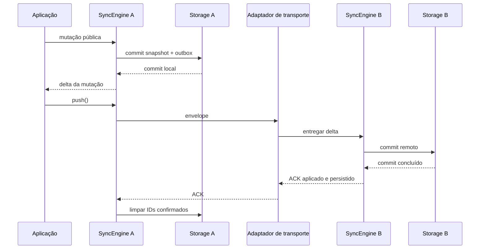
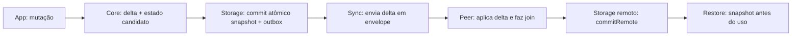

# DeltaSync

Biblioteca Dart modular para aplicações offline-first com CRDTs e sincronização incremental por deltas.

## Pacotes

- `deltasync_core`: LWW-Register, MV-Register, G-Counter, PN-Counter, G-Set,
  2P-Set, OR-Set, OR-Map, estado de réplicas e deltas.
- `deltasync_sync`: coordenação de alterações locais, pendências e deltas remotos.
- `deltasync_storage`: contrato de persistência, sem dependência de banco específico.
- `deltasync_storage_testing`: suíte reutilizável de contrato para adapters de storage.
- `deltasync_transport`: contrato de transporte, sem dependência de HTTP ou WebSocket.
- `deltasync`: facade que exporta APIs dos subpackages.

## Uso

```dart
import 'package:deltasync/deltasync.dart';

final replica = Replica('device-a');
final delta = replica.setDelta('message', 'edited offline');
final remote = Replica('device-b')..apply(Delta([delta]));
print(remote.state.values);
final apples = replica.incrementGCounter('cart/apples', 2);
final balance = replica.decrementPnCounter('account/balance', 1);
final tags = replica.addAllGSet('document/tags', ['draft', 'shared']);
final members = replica.addTwoPSet('document/members', 'device-a');
remote.apply(Delta([apples, balance, tags, members]));
print(remote.gSetValue('document/tags'));
final removal = replica.removeTwoPSet('document/members', 'device-a');
remote.apply(Delta([removal]));
print(remote.twoPSetValue('document/members'));

// MV-Register preserva escritas concorrentes até escrita observar ambas.
final localWrite = replica.writeMvRegister('document/title', 'local');
final concurrentWrite = remote.writeMvRegister('document/title', 'remote');
replica.apply(Delta([concurrentWrite]));
remote.apply(Delta([localWrite]));
print(replica.mvRegisterValue('document/title')); // {'local', 'remote'}
final resolved = replica.writeMvRegister('document/title', 'resolved');
remote.apply(Delta([resolved]));
print(remote.mvRegisterValue('document/title')); // {'resolved'}

final roleTag = replica.addOrSet('document/roles', 'reader');
remote.apply(Delta([roleTag]));
final roleRemoval = replica.removeOrSet('document/roles', 'reader');
remote.apply(Delta([roleRemoval]));
print(remote.orSetValue('document/roles')); // {}

final key = replica.addOrMapKey('document/profile', 'roles');
remote.apply(Delta([key]));
final role = replica.addOrMapValue('document/profile', 'roles', 'reader').single;
remote.apply(Delta([role]));
print(remote.orMapValue('document/profile')); // {'roles': {'reader'}}
```

Cada adaptador de storage ou transporte pertence à aplicação consumidora. SQLite, HTTP e WebSocket não são dependências do núcleo. Execute `dart run example/deltasync_example.dart` para um consumidor mínimo com duas engines conectadas; o link em memória só demonstra o contrato público e não é transporte de produção.



O fluxo integrado de `Replica`/`SyncEngine` suporta LWW, G-Counter, PN-Counter,
G-Set, 2P-Set, MV-Register, OR-Set e OR-Map com valores G-Set. Testes de
recuperação SQLite via FFI cobrem estado e outbox dos oito tipos.
`setDelta/removeDelta` produzem `LwwDelta` ordenado por HLC. `Replica.set/remove`,
`SyncEngine.set/remove` e `Delta.crdt/crdtChanges` são wrappers depreciados que encaminham ao lote nativo;
podem ser removidos na próxima versão principal. `Operation`, `Crdt`,
`CrdtOperation` e `OperationCrdt` não formam mais caminho operacional. `Operation`
fica como DTO depreciado para migração versionada.

G-Counter e PN-Counter agora entram em `Replica`/`SyncEngine` por métodos de
mutação com `crdtId` estável, como `incrementGCounter('cart/apples')` e
`incrementPnCounter('account/balance')`. Endereço identifica campo/modelo e deve
ser igual entre réplicas e após restauração. Construtores diretos `GCounter` e
`PnCounter` exigem novo argumento nomeado `crdtId`; essa quebra evita colisão
silenciosa entre instâncias. Deltas v2 carregam endereço e dot namespaced; codec
continua lendo formato v1 e atribui endereço legado por tipo/réplica. Dados v1
com IDs conflitantes não podem ser separados automaticamente e são rejeitados.
Endereços iniciados por `legacy/` são reservados. G-Counter e PN-Counter carregam
componentes cumulativos, então lacunas de dot não impedem merge. MV-Register e os
tipos observados usam dots explícitos: um contador máximo não prova que dots
anteriores chegaram.

G-Set usa `Replica.addGSet/addAllGSet` ou métodos correspondentes de
`SyncEngine`. Endereço estável identifica o campo; cada delta traz adições JSON
com dot namespaced, e o join une eventos enquanto a consulta deduplica valores
JSON estruturalmente iguais. Não há remoção. G-Set entrou no snapshot interno v4;
leitores atuais aceitam snapshots v1–v7, e o formato atual é v8. Consumidores
antigos não leem snapshot v8. O envelope externo `ReplicaSnapshot` continua v2.
`DeltaCodec` mantém v3; leitores antigos rejeitam labels desconhecidos `g-set`,
`2p-set`, `mv-register`, `or-set` e `or-map`.

2P-Set usa `Replica.addTwoPSet/addAllTwoPSet` e
`Replica.removeTwoPSet/removeAllTwoPSet`, com métodos equivalentes em `SyncEngine`.
Adições e tombstones de remoção são conjuntos monotônicos unidos no merge; valor
visível é adições menos remoções. Readição e delta antigo não ressuscitam valor
removido. Não há operação para desfazer tombstone.

MV-Register usa `Replica.writeMvRegister` e `SyncEngine.writeMvRegister`. Cada
delta guarda dot da escrita e conjunto exato de dots observados. Join une versões
e remove somente dots cobertos pelo contexto de outra versão; assim, escritas
concorrentes permanecem visíveis e delta atrasado não desfaz escrita causal. O
contexto completo sobrevive no snapshot; sem GC causal, cresce com histórico.

OR-Set usa `Replica.addOrSet/removeOrSet` e equivalentes de `SyncEngine`. Cada
adição recebe tag dot exclusivo; remoção carrega exatamente tags já observadas.
Join une adições e tombstones. Adição concorrente e readição recebem tags novas
e sobrevivem; replay de adição removida permanece oculto após restore. Snapshot
v7 introduziu tags/tombstones; leitores atuais aceitam snapshots v1–v7. Sem GC no escopo,
eventos de adição/remoção e tombstones continuam armazenados.

OR-Map usa `Replica.addOrMapKey/removeOrMapKey/addOrMapValue` e equivalentes em
`SyncEngine`. Esta composição concreta usa G-Set por chave: presença é add-wins
por tags observadas; remoção afeta só tags conhecidas; atualizações unem valores
sem substituir adições concorrentes. Recriação recebe nova tag e G-Set vazio;
deltas de valor da chave antiga ficam ocultos. Valores só crescem porque G-Set não
remove elementos; para outro tipo de valor, consumidor compõe seu contrato próprio.
Snapshot v8 preserva tags e valores.

### Compatibilidade de API e formatos

`LwwRegister<T>` e `LwwDelta<T>.fromJson` aceitam `decodeValue` para coleções
JSON tipadas. A cópia JSON interna usa `List<Object?>` e `Map<String, Object?>`;
por isso `T` como `List<int>` ou `Map<String, List<int>>` precisa de conversão
explícita na consulta e na restauração. Exemplo:

```dart
List<int> readScores(Object? json) => List<int>.from(json as List);

final register = LwwRegister<List<int>>(decodeValue: readScores);
register.applyDelta(LwwDelta<List<int>>(
  key: 'scores',
  id: 'device:1',
  replicaId: 'device',
  timestamp: const HlcTimestamp(1, 0),
  value: [1, 2],
  decodeValue: readScores,
));
final restored = LwwDelta<List<int>>.fromJson(
  register.winner!.toJson(),
  decodeValue: readScores,
);
```

Para mapas aninhados, a conversão deve reconstruir também as coleções internas e
preservar exatamente o conteúdo JSON.
`Replica` e `SyncEngine` continuam expondo LWW como `Object?`; seus valores e
snapshots são copiados. Chamadas anteriores com tipos escalares ou `Object?`
continuam válidas, exceto usos `const LwwDelta(...)`: o construtor agora copia
o valor e deixa de ser `const`; troque a declaração por `final` ou criação comum.
`LwwDelta.value` devolve cópia, inclusive de coleções aninhadas. Sem conversão,
uma coleção incompatível com `T` gera
`FormatException` em vez de falha de cast. O JSON, HLC e formato de snapshot não
mudam; consumidores de coleções tipadas adicionam a conversão nos pontos acima.

Esta consolidação altera APIs públicas. `Delta` agora recebe somente
`Iterable<DeltaChange>`; `Delta.changes` contém todas as mudanças nativas. Código
que lia `crdtChanges` pode usar o alias depreciado ou migrar para `changes`.
Adapters próprios de `ReplicaStorage` devem implementar consulta, `markSent` e
confirmação por peer. `OutboxEntry` exige exatamente uma mudança em `delta` e
registra destino;
lotes são montados no envio. Outbox v2 substitui formato v1. Migração v1 exige
informar explicitamente `legacyRecipientPeerId`; alvo desconhecido nunca é
atribuído silenciosamente. `operation:` foi removido. `Replica.set`
e `Replica.remove` continuam como aliases depreciados, mas retornam `LwwDelta`;
código tipado como `Operation` deve migrar para `LwwDelta<Object?>`. `Crdt`,
`CrdtOperation` e `OperationCrdt` foram removidos. Consumidores externos não foram
inventariados; devem compilar contra os contratos públicos acima e adaptar
subclasses próprias de `DeltaChange` para metadados `kind`, `crdtId` e `replicaId`.
`ReplicaSnapshot` atual recebe payload canônico; adaptadores leem objeto antigo
com `ReplicaSnapshot.fromJson` e convertem antes de escrever. Outboxes antigas com
várias mudanças por entrada devem ser divididas em uma entrada por mudança na
migração. `PendingDeltaStore` e `MemoryPendingDeltaStore` seguem depreciados como
ponte; API nova usa `SyncEngine.withStorage`.

Inventário público após consolidação: `deltasync_core` exporta contratos e tipos
de mudança (`DeltaChange`, `CrdtKind`, `Delta`, `DeltaCodec`, `DeltaCrdt`),
`Replica`/`ReplicaState`, LWW/counters, HLC, identidade e clocks; `Operation` e
`migrateLegacyOperation` existem só para converter dados antigos. `deltasync_storage`
exporta `ReplicaStorage`, `ReplicaSnapshot`, `OutboxEntry`, `OutboxStatus`,
`MemoryStorage`, `PendingDeltaStore` e `MemoryPendingDeltaStore`. Os dois últimos
permanecem depreciados como adaptador de migração; fluxo novo usa
`SyncEngine.withStorage` e `ReplicaStorage`. `deltasync_sync`
exporta `SyncEngine` e `SyncRetryPolicy`; `deltasync_transport` exporta
`DeltaTransport`, `AcknowledgingDeltaTransport`, `DeltaEnvelope`,
`DeltaAcknowledgement` e `DeltaAckStage`. A facade `deltasync` reexporta esses
quatro pacotes.

`DeltaCodec` grava versão 3 (`delta.changes`). Lê versões 1 e 2 antigas, convertendo
operações LWW em `LwwDelta`: soma dos componentes de `VectorClock` vira timestamp
físico sintético; `replicaId` e ID preservam desempate antigo. Vetores cuja soma
excede o intervalo suportado são rejeitados. Snapshots internos versões 1 a 7
continuam legíveis, inclusive `legacyWinner` nos formatos antigos. A gravação
atual usa versão 8 e guarda
sequências por origem para bootstrap compacto. Conversão fica no codec/snapshot
restore, não no caminho normal de `Replica.apply`.

`DeltaTransport` fica vinculado a um `peerReplicaId` e envia/recebe
`DeltaEnvelope` v2, com remetente, destinatário e payload `DeltaCodec`. Remetente
pode diferir das origens CRDT em mudanças encaminhadas. A API não escolhe protocolo:
adapters serializam `toJson()` e validam `fromJson()`. `DeltaTransport.send`
concluído significa transmissão local; ACK `received` confirma só recebimento;
somente `appliedAndPersisted` do destinatário configurado remove IDs daquela
outbox. Outbox mantém cópia por peer; peer offline recebe retry quando volta, e
trocar adapter para outro peer não transfere pendências nem amplia confirmação.
Decoder aceita envelope v1 só com `legacyRecipientReplicaId` explícito; adapters
antigos também precisam migrar a assinatura pública.

`Replica.export()` emite bootstrap compacto: vencedor LWW por endereço e
componente cumulativo mais recente por origem para counters. `Replica.mergeSnapshotJson()`
faz bootstrap por snapshot sem trocar identidade; `SyncEngine.applyRemoteSnapshot()`
grava esse merge com `commitRemote`, sem criar pendência local. `export()` não é
log completo, outbox nem histórico de ACK. Use `toSnapshotJson/exportSnapshot()` e
`fromSnapshotJson()` para persistir/restaurar estado completo, inclusive tombstones,
clocks e sequências. ID conflitante é rejeitado enquanto corresponder ao vencedor
retido ou ao último estado conhecido do componente; não há deduplicação ilimitada
de todo ID histórico após restauração. Snapshots internos v1/v2 sem sequências de
origens remotas podem ser mesclados por `mergeSnapshotJson`; `export()` não inventa
dots ausentes. Use transferência direta do snapshot para bootstrap desse estado.

### Onde alterar cada tipo

- **LWW:** `Replica.setDelta/removeDelta` criam mudança e HLC em
  `packages/deltasync_core/lib/src/replica.dart`; `LwwRegister` mantém vencedor e
  tombstone; `ReplicaState` roteia pelo endereço. Join escolhe maior HLC, depois
  `replicaId` e ID. Snapshot passa por `Replica.toSnapshotJson/fromSnapshotJson`.
  Regressões ficam em `crdt_interfaces_test.dart` para tombstone, ordem, migração e
  snapshot, e em `lww_typed_json_test.dart` para coleções tipadas e isolamento.
- **G-Counter:** mutação, componente cumulativo e join por máximo vivem em
  `g_counter.dart`; `Replica` roteia pelo `crdtId` e snapshot restaura componentes
  e sequência. Testes cobrem máximos, lote misto, codec e sequência restaurada.
- **PN-Counter:** positivos, negativos, validação completa e join por máximo vivem
  em `pn_counter.dart`; delta público transporta ambos os componentes. Testes cobrem
  convergência, decremento, delta inválido sem efeito parcial e sequência.
- **G-Set:** `g_set.dart` valida e copia elementos JSON, gera adições incrementais
  e une deltas por ID. `Replica` faz roteamento, isolamento, export e snapshot;
  `SyncEngine` grava mudanças na outbox. Testes cobrem join, ordem, duplicação,
  codec e duas engines.
- **2P-Set:** `two_p_set.dart` mantém adições e tombstones monotônicos; valor é a
  diferença dos conjuntos. `Replica` roteia e versiona snapshot; `SyncEngine`
  comita operações na outbox. A semântica não permite readição após remoção.
- **MV-Register:** `mv_register.dart` mantém dots observados, versões ativas e
  contexto causal exato; contexto registra lacunas sem inferir entrega por contador
  máximo. Join une versões e elimina as que foram observadas por outra versão.
  `Replica` roteia, exporta e restaura; `SyncEngine` persiste cada escrita na
  outbox. Testes cobrem concorrência, entrega atrasada, join, JSON e duas engines.
- **OR-Set:** `or_set.dart` mantém adições por tag dot e remoções por conjunto de
  tags observadas. Join une ambos, sem usar contador máximo como prova de entrega.
  `Replica` roteia, exporta e restaura; `SyncEngine` comita adição/remoção na
  outbox. Testes cobrem adição concorrente, readição, replay antigo e duas engines.
- **OR-Map:** `or_map.dart` mantém tags de chave e compõe G-Set independente por
  encarnação. Remoção não apaga valor concorrente de outra tag; recriação não
  reutiliza valor antigo. `Replica` e `SyncEngine` roteiam/commitam mudanças; testes
  mostram API e pontos de manutenção sem framework genérico de objetos.
- **Contrato/wire:** `delta_change.dart` define metadados comuns e labels estáveis;
  `delta.dart` agrupa/mescla mudanças e `delta_codec.dart` versiona serialização.
  `delta_envelope.dart` acrescenta envelope de transporte. Testes pertinentes ficam
  nos pacotes core e transport.

### Percurso de integração e manutenção

O PDF usa nomes conceituais para operações que hoje pertencem a contratos
distintos. Esta tabela orienta a leitura sem criar aliases na API:

| Conceito no PDF | API atual | Responsabilidade |
|---|---|---|
| `query()` | `value` do CRDT ou consulta da aplicação sobre `Replica` | Leitura de valor; a regra de negócio e o mapeamento de modelos ficam no consumidor. |
| `merge(other)` | `mergeState(other)` | Join de estado entre instâncias compatíveis do mesmo CRDT. |
| `generateDelta()` | Métodos de mutação, como `setDelta()` ou `addOrSet()` | A mutação local produz deltas; `SyncEngine` com storage também os registra na outbox. |
| `applyDelta(delta)` | `applyDelta()` no CRDT; `Replica.apply(Delta)` ou `SyncEngine.applyRemote(Delta)` | Aplicação de mudança; no engine, commit remoto antes de adoção. |
| `toJson()` | `DeltaCodec.encode()` para delta; `Replica.toSnapshotJson()` para estado | Codificações diferentes para mudança e snapshot; não intercambiáveis. |
| `fromJson(...)` | `DeltaCodec.decode()` ou `Replica.fromSnapshotJson()` | Decodificação validada de delta ou restauração de estado, conforme o formato. |

Fluxo de uma edição offline com storage: a aplicação chama a API de mutação;
`SyncEngine` prepara estado candidato e delta, `ReplicaStorage.commit` grava
snapshot e outbox atomicamente, e só então o engine adota o estado. No recebimento,
decodifica-se o envelope/delta, aplica-se o join e `commitRemote` grava o snapshot;
na abertura seguinte, `start()` restaura o snapshot antes das operações.
O delta contém mudanças tipadas; `DeltaEnvelope` acrescenta versão e endereços de
sender/recipient para transporte, sem assumir protocolo de rede.



Um percurso real para contribuidores é a inclusão do OR-Set: comportamento e
invariantes vivem em `packages/deltasync_core/lib/src/or_set.dart`; roteamento e
snapshot em `replica.dart`; persistência da mutação em `packages/deltasync_sync/lib/src/sync_engine.dart`.
Comece por `packages/deltasync_core/test/or_set_test.dart`, siga para
`packages/deltasync_sync/test/sync_engine_test.dart` e para os testes do adaptador
SQLite quando mudar persistência. Tags dot identificam adições; remoção só elimina
tags observadas, e join une tags sem inferir entrega pelo contador máximo. Mudanças
de formato devem preservar os codecs/versionamento e snapshots legados documentados
em [compatibilidade](#compatibilidade-de-api-e-formatos).

Para implementar outro storage, implemente diretamente o contrato público
`ReplicaStorage` em `packages/deltasync_storage/lib/src/replica_storage.dart` e
execute `replicaStorageContractTests` da fixture em
`packages/deltasync_storage_testing`. `commit` deve tornar snapshot e novas entradas
de outbox visíveis juntos, ou manter ambos anteriores quando falhar; `commitRemote`
não apaga outbox local. O adaptador de referência e os testes de recuperação ficam
em `packages/deltasync_storage_sqflite`. Core, sync e contrato não exigem banco ou
Flutter; o consumidor escolhe e fornece o backend ao compor `SyncEngine.withStorage`.

### Storage

`ReplicaStorage` é o contrato oficial para persistência. A aplicação deve fornecer
um adaptador persistente quando precisar recuperar estado após reinício, como um
adaptador SQLite, Hive, Isar ou arquivos.

`MemoryStorage` é apenas uma implementação volátil de referência. Serve para
testes, exemplos e protótipos; todos os dados são perdidos quando o processo
termina e não deve ser usado como storage de produção.

Adaptadores de `ReplicaStorage` devem implementar `commit` para gravar snapshot
canônico e entradas novas da outbox atomicamente, e `commitRemote` para substituir
snapshot após merge remoto. Falha deve preservar estado anterior. Cada entrada
outbox contém uma mudança; `SyncEngine` combina entradas em lote só no envio.
`markSent` grava status, tentativa e horário antes da transmissão para permitir
retry com backoff; `acknowledge` remove apenas IDs confirmados do peer. Suíte
compartilhada para validar adapters está em `deltasync_storage_testing`.
Para a mesma réplica, peer e ID de mudança pendente, `commit` e `enqueue`
aceitam conteúdo de delta equivalente sem substituir status, tentativas ou
horários existentes. Conteúdo divergente lança `FormatException`; `commit`
preserva snapshot e outbox anteriores. A suíte compartilhada exercita ambos os
casos em MemoryStorage e SQLite. O schema e o JSON persistido não mudaram.
`ReplicaSnapshot` v2 guarda payload `Replica.toSnapshotJson()` sem duplicar
estado/clock em campos paralelos. O reader aceita snapshot v1 com
`metadata['replicaState']` ou delta reexecutável; estado legado sem dados suficientes
é rejeitado. Snapshots restaurados são regravados no formato atual ao iniciar.
`saveReplica` serve a bootstrap/manutenção sem pendências; `enqueue` importa uma
pendência fora de mutação local. Edições usam commit atômico.
No adaptador SQLite, uma falha transitória ao abrir o banco permite repetir
`SyncEngine.start()` com os mesmos objetos; a restauração termina antes de novas
edições. Erros de schema continuam explícitos e não migram dados automaticamente.

`ReplicaState` exposto por `Replica.state` é cópia isolada; consultas devolvem
coleções aninhadas imutáveis. `SyncEngine` clona a `Replica` recebida e `engine.replica`
devolve visão destacada, então escrita direta não contorna commits. Mutações passam
por preparação, commit e adoção comuns; falha mantém estado/outbox prévios. Forks
preservam fonte de tempo HLC injetada.

### Confirmação e retry

`DeltaTransport.send` concluir significa apenas que transmissão local terminou.
`AcknowledgingDeltaTransport.sendAndAwaitAck` retorna peer e estágio explícitos;
`received` não confirma mudança, `appliedAndPersisted` confirma aplicação e commit
remoto durável. ACK parcial remove apenas IDs confirmados para aquele peer. Sem ACK,
`ReplicaStorage` conserva mudanças para retry. `SyncRetryPolicy.maxAttempts` limita retries automáticos; `push(force: true)`
ignora atraso e limite para retransmissão manual. `SyncEngine` aceita ACK somente
para IDs do lote enviado, peer configurado e outbox da réplica local. O legado `PendingDeltaStore`
não armazena tentativas nem ACKs: mudanças enviadas ficam pendentes e cada `push`
pode reenviá-las sem limite; `force` não altera esse comportamento. ACK confirma
entrega, nunca autoriza coleta de tombstones. Topologia coberta é enlace ponto a
ponto de peer fixo; garantias não se estendem a peers além dele. Se o adaptador
remoto não puder provar commit durável, não deve reportar `appliedAndPersisted`.
`pending` significa tentativa zero; `sent` conta tentativa iniciada e exige
`sentAt`. ACK remove entrada; `confirmed` só é lido em registros legados.

`SyncEngine` inicia automaticamente antes da primeira operação; também aceita
`start()` explícito e chamadas repetidas após sucesso. `lifecycle` expõe
`created/starting/started/disposed`; falha de início retorna a `created` e permite
retry. `replica` só fica consultável após restauração. Mutação concluída significa
commit local, não confirmação remota.
`pendingDelta()` consulta alterações ainda retidas localmente; `push()` retorna
`SyncPushResult` com delta enviado, estágio do ACK (quando existe) e IDs
incorporados/persistidos. `fullyAcknowledged` é falso quando transporte não fornece
ACK ou confirma só parte do lote. Falhas chamadas
diretamente são lançadas ao chamador; `errors` expõe falhas de processamento do
stream remoto e erros emitidos pelo stream de transporte. `dispose()` é terminal,
cancela recepção, aguarda operações já iniciadas e rejeita novas operações.
`PendingDeltaStore` não consegue remover uma mudança, mesmo após ACK remoto;
resultado de push confirma transporte, enquanto `pendingDelta()` revela retenção
local e possível reenvio. Esse adaptador legado não grava destino por peer e serve
somente à migração de um enlace fixo; garantias por peer exigem `ReplicaStorage`.

```dart
final engine = SyncEngine.withStorage(
  replica: Replica('device-a'),
  storage: storage,
  transport: transport,
);
final errors = engine.errors.listen((failure) => print(failure.error));
await engine.start();
await engine.setDelta('title', 'edited offline'); // commit local concluído
final pending = await engine.pendingDelta();
final result = await engine.push(); // estágio em result.acknowledgement?.stage
final confirmed = result.acknowledgedIds; // só aplicado e persistido
await engine.dispose();
await errors.cancel();
```

### Escopo da persistência

Cada dispositivo persiste somente sua própria réplica. O estado completo das
outras réplicas não é armazenado localmente.

O adaptador [SQLite/sqflite](packages/deltasync_storage_sqflite/README.md)
implementa `ReplicaStorage`. Cada dispositivo persiste seu snapshot canônico e
outbox em tabelas próprias; estado, clocks, tombstones e sequências ficam no
payload versionado do snapshot. Commit local grava snapshot e outbox na mesma
transação. Commit remoto troca snapshot sem apagar pendências locais. Consumidor
fornece factory SQLite compatível com sua plataforma.

O `VectorClock` pode conter identificadores e contadores de outras réplicas.
Isso registra conhecimento causal, não o estado completo delas. Operações
remotas podem aparecer como operação vencedora ou ser resumidas pelo relógio,
sem exigir armazenamento da réplica remota inteira.

Uma tabela adicional de operações pode ser criada futuramente para auditoria,
replay, histórico ou deduplicação explícita. Confirmações por participante
também podem ser persistidas futuramente para orientar compactação segura de
operações e tombstones. Nenhuma dessas extensões armazena estados completos de
outras réplicas.

### Demonstração offline com SQLite

Consumidor pequeno mapeia nomes de compradores para campos LWW e total de itens
para G-Counter. Cada comando abaixo roda em processo separado; edições offline e
outbox sobrevivem no banco entre execuções.

```sh
dart run example/offline_reconciliation.dart reset
dart run example/offline_reconciliation.dart offline
# Processo encerra aqui; iniciar novo processo para reconectar.
dart run example/offline_reconciliation.dart reconnect
```

Resultado esperado: fase offline mostra commit local, duas pendências por réplica
e falha de peer indisponível, sem perder edição. Reconexão restaura snapshots e
outboxes, entrega e confirma deltas; ambas réplicas mostram os dois compradores e
total cinco. Reabertura final confirma estado convergente e outboxes vazias.
Exemplo foi executado em Linux x64 com SQLite real via `sqflite_common_ffi`;
outros desktops e usabilidade com participantes não foram avaliados.

O [consumidor Flutter Android](example/flutter_mobile/README.md) usa a factory do
plugin `sqflite` e reproduz esse percurso pela UI. VAL-07 executou o app no
Moto G52 com Android 13, incluindo dois reinícios reais de processo, restauração
da outbox e confirmação durável. O exemplo resolve os pacotes locais em workspace
próprio; core, sync e contrato de storage continuam Dart puro. iOS não foi avaliado.

### Medição de tamanho

`dart run example/measure_delta_size.dart` mede as quatro mutações offline acima
antes da reconexão: cada réplica altera um nome LWW e seu componente G-Counter.
Script fixa IDs, valores, quantidade e relógio HLC. Conta bytes UTF-8 de JSON
compacto: `DeltaCodec` para mudanças, `DeltaEnvelope` v2 para mensagem completa e
`Replica.toSnapshotJson()` para snapshot de cada réplica. Delta inclui metadados das
mudanças; envelope acrescenta versão, remetente e destinatário; snapshot inclui
estado materializado, clocks e metadados de réplica. Não inclui whitespace, gzip,
headers, protocolo ou armazenamento SQLite.

Resultado reproduzido duas vezes em Dart/Linux x64:

| Réplica | Mutações | Delta | Envelope | Snapshot |
|---|---:|---:|---:|---:|
| `shopper-a` | 2 | 454 B | 539 B | 627 B |
| `shopper-b` | 2 | 455 B | 540 B | 628 B |
| Total | 4 | 909 B | 1.079 B | 1.255 B |

Neste cenário, envelopes somam 86,0% dos snapshots separados (14,0% menos bytes).
Isso compara a soma das duas mensagens destinadas ao peer fixo com os dois estados
locais antes da reconexão. Resultado descreve apenas esse JSON, payload, valores e
implementação; não demonstra ganho geral nem estima tráfego comprimido ou de rede.

## Validação

Testes da raiz cobrem somente a facade. Validar também cada subpacote:

```shell
dart pub get
for package in . packages/deltasync_core packages/deltasync_sync packages/deltasync_storage packages/deltasync_storage_sqflite packages/deltasync_transport; do
  (cd "$package" && dart analyze && dart test) || exit 1
done
```

## Planejamento

Para executar tarefa com leitura, implementação, review, validação e atualização
do plano, pedir `$plan-executor Execute R-01` ou “execute a próxima tarefa do plano”.
Veja [guia de uso](plan/RUNBOOK.md).

- [Contexto atual e relação com o PDF acadêmico](proposta.md).
- [Plano: fases, tarefas, prioridades e gates](plan/README.md).
- [Correções da implementação existente](plan/01_PHASE1_CORRECOES.md).
- [Rastreabilidade e evidências](plan/TRACEABILITY.md).
- [Instruções e procedimentos de trabalho](AGENTS.md).
